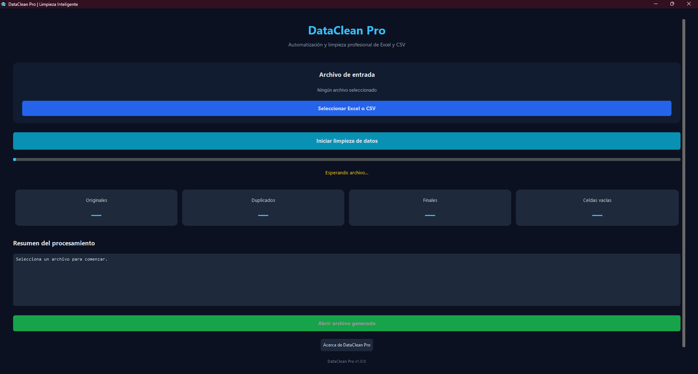
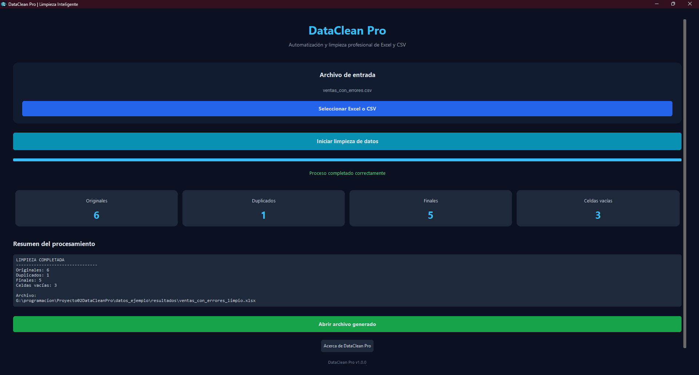
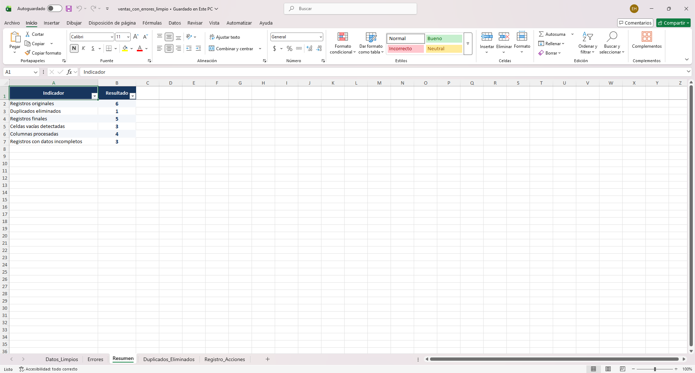

# 🧹 DataClean Pro v1.0.0

### Limpieza y automatización de datos con Python

DataClean Pro es una aplicación de escritorio para Windows desarrollada en Python que permite limpiar, analizar y organizar archivos Excel y CSV mediante una interfaz gráfica moderna.

Su objetivo es facilitar la preparación de datos, detectar problemas comunes y generar reportes estructurados de manera automática.

## 🚀 Características principales

- Importación de archivos Excel (.xlsx) y CSV (.csv).
- Limpieza de espacios innecesarios en textos y encabezados.
- Detección y eliminación de registros duplicados exactos.
- Identificación de celdas vacías.
- Conservación de registros incompletos.
- Generación automática de reportes Excel.
- Resumen de estadísticas del procesamiento.
- Interfaz gráfica moderna con CustomTkinter.
- Procesamiento independiente para mantener la interfaz disponible.
- Protección contra múltiples instancias de la aplicación.

## 📊 Reportes generados

El archivo Excel de salida contiene cinco hojas:

| Hoja | Descripción |
|------|-------------|
| Datos_Limpios | Registros procesados y sin duplicados exactos |
| Errores | Celdas vacías detectadas |
| Resumen | Estadísticas generales |
| Duplicados_Eliminados | Registros duplicados identificados |
| Registro_Acciones | Operaciones realizadas durante la limpieza |

Los archivos generados se guardan en una carpeta llamada `resultados`, junto al archivo de origen.

## 🛠️ Tecnologías utilizadas

- Python
- Pandas
- OpenPyXL
- CustomTkinter
- Pillow
- Multiprocessing

## 💻 Instalación desde el código fuente

Requisitos: Python compatible con las dependencias del proyecto.

1. Descarga o clona el repositorio.
2. Abre una terminal en la carpeta del proyecto.
3. Crea un entorno virtual:

```bash
python -m venv .venv
```

4. Activa el entorno virtual en Windows:

```powershell
.venv\Scripts\Activate.ps1
```

5. Instala las dependencias:

```bash
python -m pip install -r requirements.txt
```

6. Inicia la aplicación:

```bash
python interfaz_moderna.py
```

## 📁 Uso

1. Abre DataClean Pro.
2. Selecciona un archivo Excel o CSV.
3. Presiona "Iniciar limpieza de datos".
4. Espera a que termine el procesamiento.
5. Revisa las estadísticas mostradas.
6. Abre el archivo Excel generado.

## 📷 Capturas de pantalla

### Interfaz principal


### Resultado del procesamiento


### Reporte Excel generado


## 📦 Ejecutable para Windows

DataClean Pro también cuenta con una versión ejecutable para Windows.

La descarga se publicará en la sección **Releases** del repositorio.

## 👨‍💻 Desarrollador

**Emmanuel Hernández Morales**

Desarrollo de software, automatización y procesamiento de datos con Python.

GitHub: https://github.com/TaterZombie115

## 📌 Versión

**DataClean Pro v1.0.0**

Primera versión pública del proyecto.
